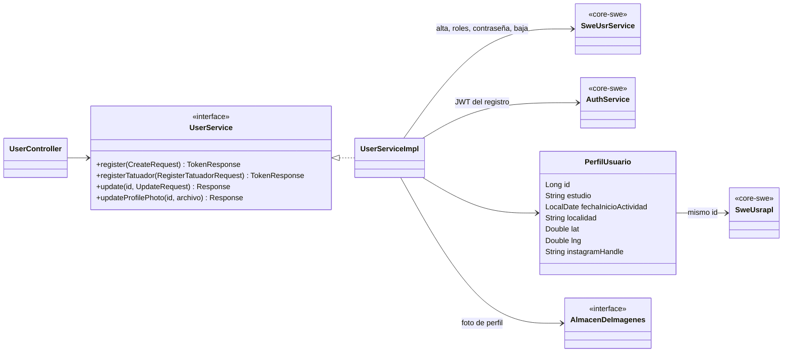
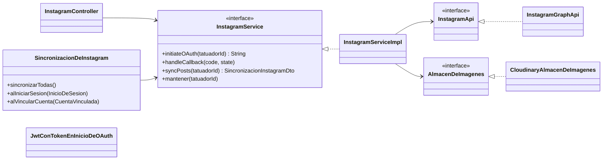
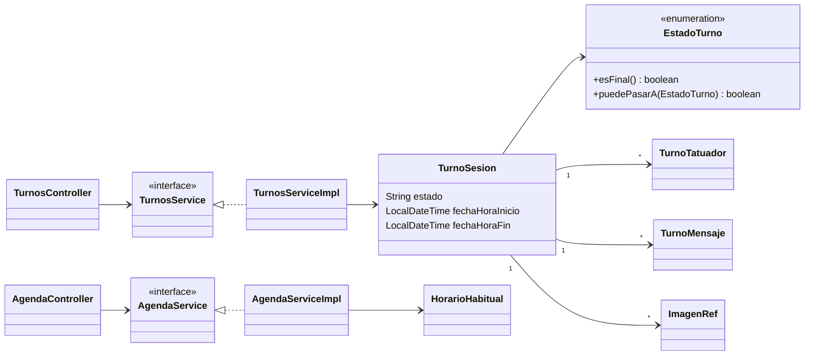
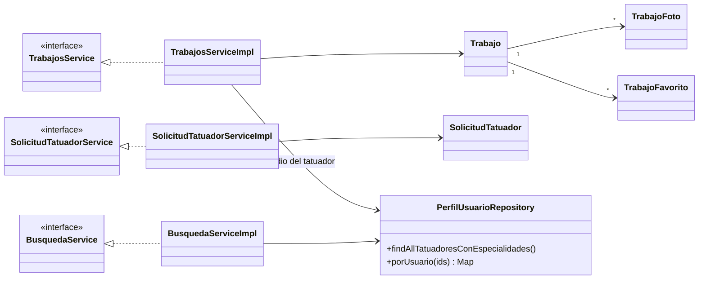

# Diagramas de clases

Un diagrama por módulo. Lo que viene de `dmc00-core` (usuarios, login, menú, errores) está en
`dmc00-core/docs/diagramas/`.

## Usuarios y perfil

## Instagram

`InstagramApi` y `AlmacenDeImagenes` son puertos: los tests usan `InstagramApiFalsa` y un almacén falso
(`DoblesDePrueba`).

## Turnos y agenda

## Trabajos, búsqueda y solicitudes

