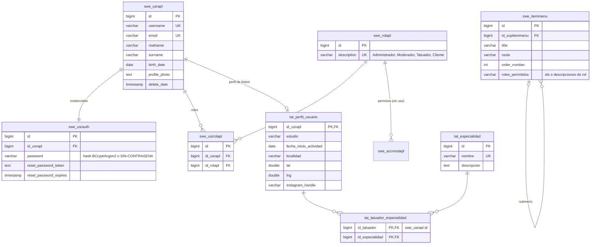
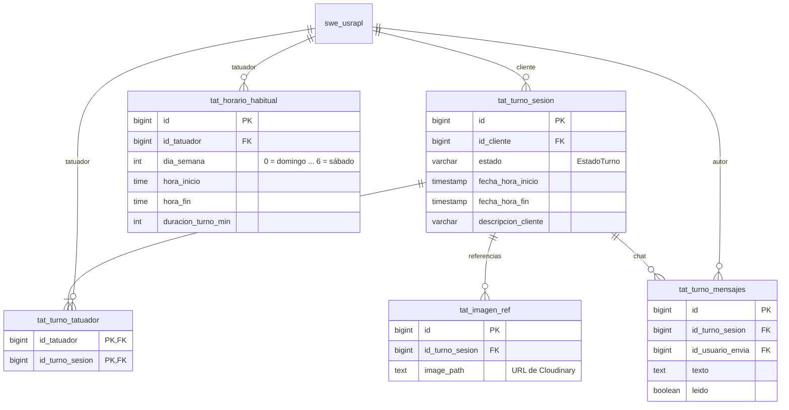
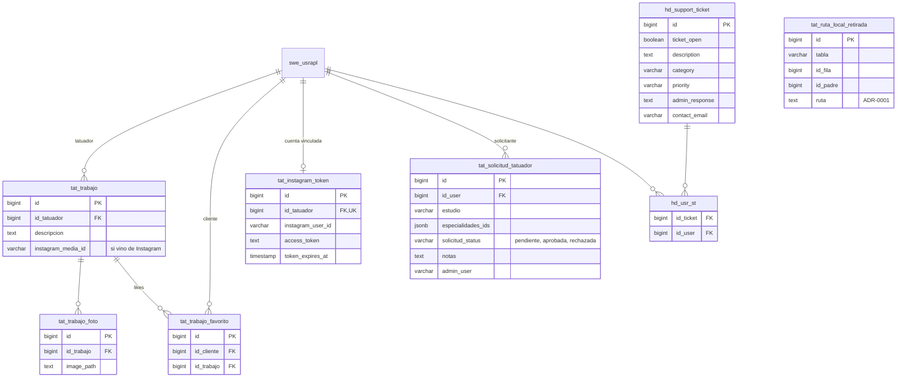

# Modelo entidad-relación

Las tablas con el mismo nombre que en la base. Se actualiza en la misma rama que la migración.
Las columnas de auditoría de `BaseEntity` (`version`, `creationuser`, `creationtimestamp`,
`modificationuser`, `modificationtimestamp`, `status`) están en casi todas las tablas y no se repiten.

## Usuarios (tablas `swe_*` de core-swe y perfil de linked)

`swe_*` las crearon las V1..V16 de linked y las completa core-swe (historial `flyway_historial_swe`,
ADR-0003 de dmc00-core). Lo propio de linked está en `tat_perfil_usuario` (V19, ADR-0004 de dmc00-core).
Las columnas viejas de `swe_usrapl` (`estudio`, `fecha_inicio_actividad`, `localidad`, `lat`, `lng`,
`instagram_handle`) siguen en la tabla hasta la versión siguiente, pero ya no se leen.

## Turnos y agenda

## Portfolio, Instagram, solicitudes y soporte

