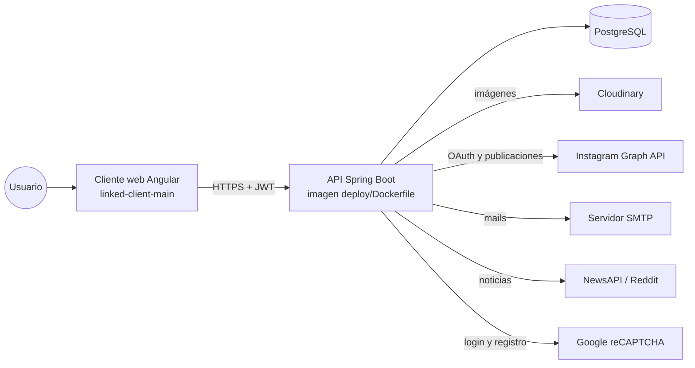

# Despliegue

Dónde corre cada pieza y cómo se conectan. El destino previsto es Fly.io con PostgreSQL administrado
(playbook en `dmc00-deploy-templates`); todavía no hay `cd.yml` ni `fly.toml` en este repo.

| Pieza | Dónde | Secretos que necesita |
|---|---|---|
| API | contenedor `eclipse-temurin:25-jre`, usuario no root, `tini` como PID 1, puerto 8080 | ver `.env.example` (perfil `prod`) |
| Base | PostgreSQL 17; Flyway con dos historiales: `flyway_schema_history` (linked) y `flyway_historial_swe` (core-swe) | `DATABASE_URL`, `DATABASE_USER`, `DATABASE_PASSWORD` |
| Clave RSA | `RSA_PRIVATE_KEY` (PEM), la misma en todas las máquinas | — |
| Salud | `GET /actuator/health` (público) | — |
