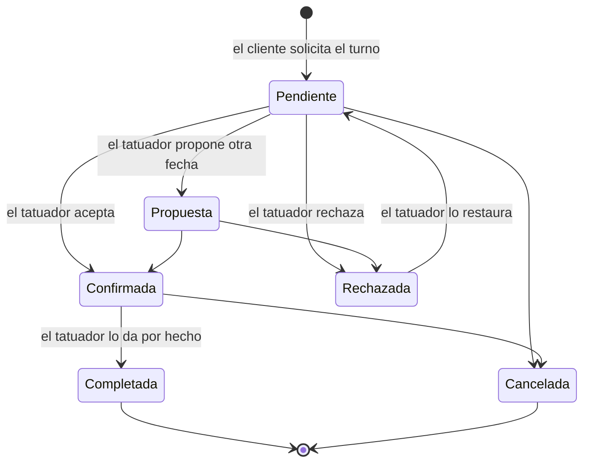
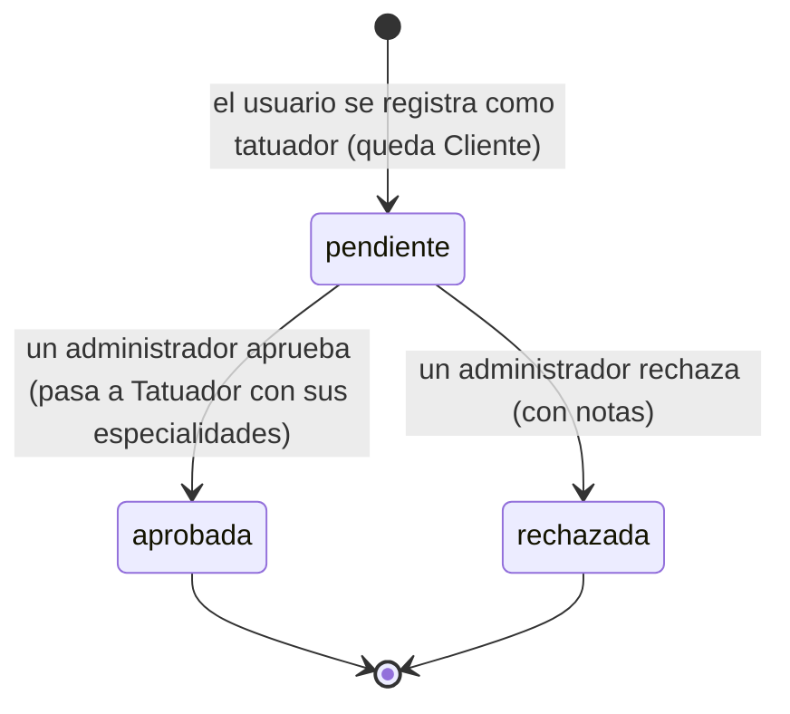
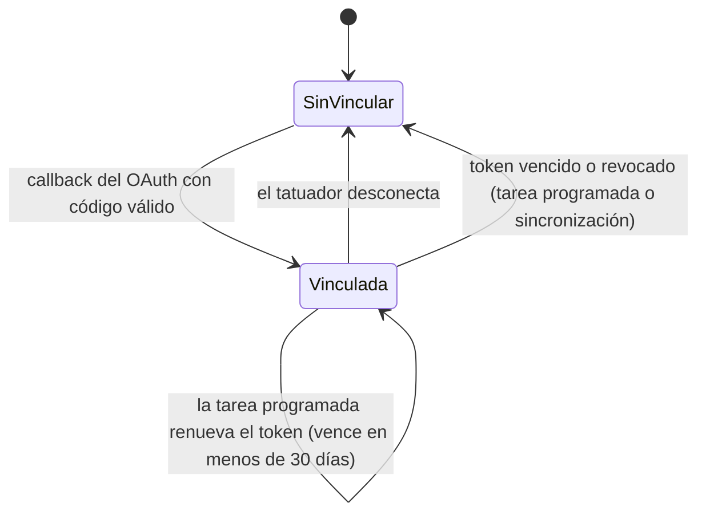

# Máquinas de estado

Tienen que coincidir con el enum que las implementa.

## Turno (`EstadoTurno`, `tat_turno_sesion.estado`)

El turno nace Pendiente al pedirlo el cliente. El backend solo impide cambiar un turno ya Completada o
Cancelada (409 `TURNO_CERRADO`), igual que Node; el resto de los cambios los decide el tatuador asignado
(`PATCH /api/turnos/gestionar/{id}` o `PUT /api/turnos/{id}`). Las flechas son las que usa hoy el cliente
web.

Los turnos Pendiente, Confirmada y Propuesta ocupan la agenda del tatuador (no se ofrecen esos horarios y
no se puede pedir otro que se superponga); Cancelada y Rechazada la liberan.

## Solicitud para ser tatuador (`SolicitudStatus`, `tat_solicitud_tatuador.solicitud_status`)

Una solicitud ya procesada no se puede volver a aprobar ni rechazar (400).

## Cuenta de Instagram de un tatuador (`tat_instagram_token`)

