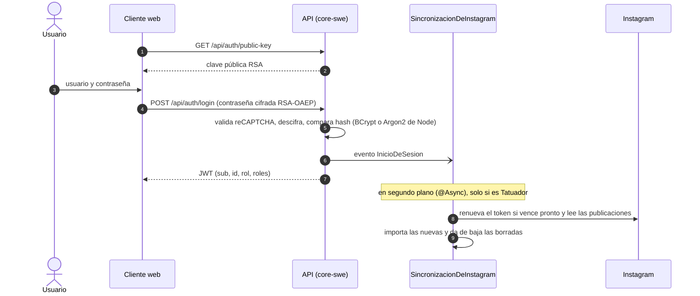
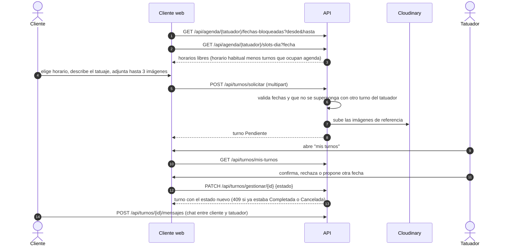
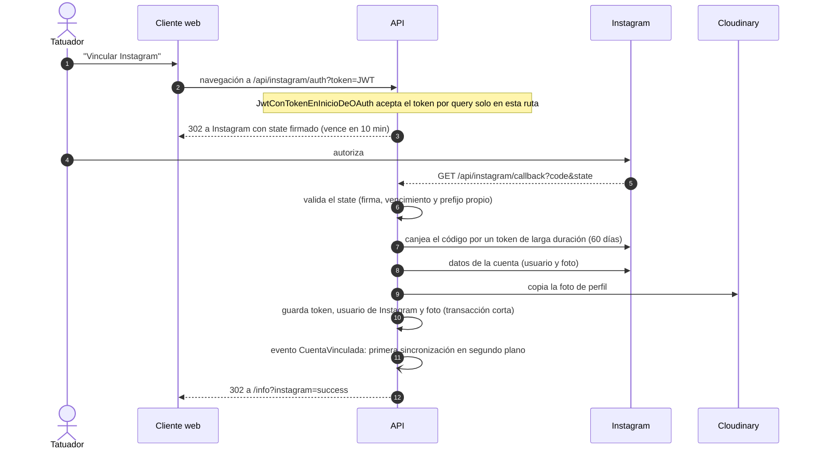
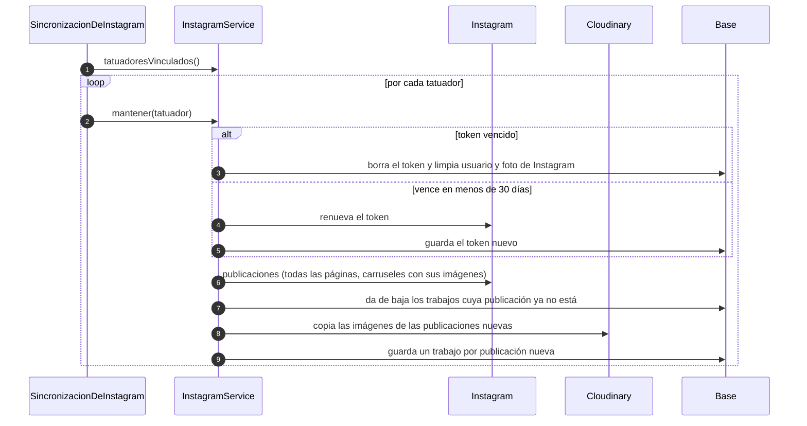

# Diagramas de secuencia

Los flujos que cruzan más de una capa o sistema.

## Login (y sincronización de Instagram de los tatuadores)

## Reserva de un turno

## Vinculación de Instagram

## Sincronización programada de Instagram (cada 2 h)

